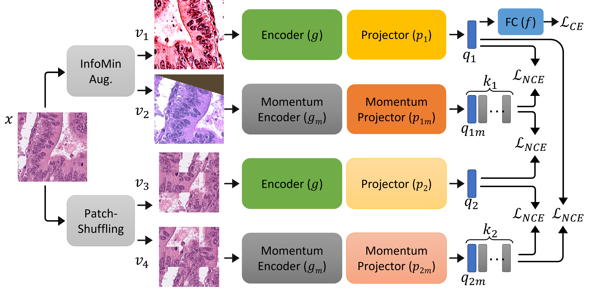

## IMPaSh

Implementation of [[arXiv]](https://arxiv.org/abs/2208.11052)
"IMPaSh: A Novel Domain-shift Resistant Representation for Colorectal Cancer Tissue Classification"
by Trinh Thi Le Vuong, Quoc Dang Vu, Mostafa Jahanifar, Simon Graham, Jin Tae Kwak, and Nasir Rajpoot. ECCV Workshop 2022.

<p align="center">
  
</p>

Built on [PyContrast](https://github.com/HobbitLong/PyContrast) (see [LICENSE](LICENSE)).
Backbone: ResNet-50. Source domain: K19 (NCT-CRC-HE-100K). Target domain: K16 (Kather 2016, COMPLEX class removed).

### Model weights

On Hugging Face: **[trinhvg/IMPaSh](https://huggingface.co/trinhvg/IMPaSh)**

| File | Contents |
|---|---|
| `impash_resnet50_k19.pth` (130 MB) | **Use this.** Encoder `g` + projectors `p1`, `p2`, the classifier `Linear(128 → 9)`, and a config (classes, input, flags) |
| `original/encoder_ckpt_epoch_200.pth` (457 MB) | Original pre-training checkpoint; also holds the momentum encoder, queues and optimizer for resuming |
| `original/classifier_ckpt_epoch_40.pth` | Original linear classifier checkpoint |

The bundle is built from the two original checkpoints and gives identical outputs.

```python
import torch
from huggingface_hub import hf_hub_download
from networks.build_backbone import RGBMultiHeadsStitch

ckpt = torch.load(hf_hub_download('trinhvg/IMPaSh', 'impash_resnet50_k19.pth'), map_location='cpu')
model = RGBMultiHeadsStitch('resnet50', head='mlp', feat_dim=128)
model.load_state_dict(ckpt['model'])
clf = torch.nn.Linear(128, 9)
clf.load_state_dict(ckpt['classifier'])
model.eval()
classes = ckpt['config']['classes']   # ADI, BACK, DEB, LYM, MUC, MUS, NORM, STR, TUM

# x: (B, 3, 224, 224), ImageNet-normalised RGB
with torch.no_grad():
    feat = model(x, mode=1)   # p1(g(x)), 128-d, L2-normalised
    logits = clf(feat)        # 9 K19 classes
```

To run the scripts below with the released weights, put the original checkpoints where `scripts/run_paper.sh` expects them:

```bash
python - <<'EOF'
import os, shutil
from huggingface_hub import hf_hub_download
run = 'k19_224_InfoMin_resnet50_RGB_Jig_True_JigStitch_True_JigEMA_True_V0_moco_aug_D_mlp_0.15_cosine'
for src, dst in [('original/encoder_ckpt_epoch_200.pth', f'save/{run}/ckpt_epoch_200.pth'),
                 ('original/classifier_ckpt_epoch_40.pth', f'save_9/{run}_linear_head_emahead_False_onk19_RA_0.2/ckpt_epoch_40.pth')]:
    os.makedirs(os.path.dirname(dst), exist_ok=True)
    shutil.copy(hf_hub_download('trinhvg/IMPaSh', src), dst)
EOF
```

### Results on K16 (unseen target domain)

| | Acc | Re | Pre | F1 |
|---|---|---|---|---|
| Paper (Table 1 / 2) | 0.868 | 0.868 | 0.887 | 0.865 |
| Released weights, re-run 2026-10-12 | 0.8674 | 0.8674 | 0.8867 | 0.8645 |

The re-run gets 3795 instead of 3796 of 4375 images right, because of resize differences between library versions. [results/paper_results_k16.csv](results/paper_results_k16.csv) traces every Table 1–2 number to its run (raw exports in `results/source/`).

### Snippet of the PatchShuffling module

The version used for training is `ReJigsawCrop` in [datasets/util.py](datasets/util.py).

```python
import numpy as np
from random import shuffle
from PIL import Image

class PatchShuffling(object):
    """
     PatchShuffling Module
    """
    def __init__(self, n_grid=3, img_size=255, crop_size=64):
        self.n_grid = n_grid
        self.img_size = img_size
        self.crop_size = crop_size
        self.grid_size = int(img_size / self.n_grid)
        self.side = self.grid_size - self.crop_size

        yy, xx = np.meshgrid(np.arange(n_grid), np.arange(n_grid))
        self.yy = np.reshape(yy * self.grid_size, (n_grid * n_grid,))
        self.xx = np.reshape(xx * self.grid_size, (n_grid * n_grid,))

        self.re_yy = np.reshape(yy * self.crop_size, (n_grid * n_grid,))
        self.re_xx = np.reshape(xx * self.crop_size, (n_grid * n_grid,))

    def __call__(self, img):
        r_x = np.random.randint(0, self.side + 1, self.n_grid * self.n_grid)
        r_y = np.random.randint(0, self.side + 1, self.n_grid * self.n_grid)
        img = np.asarray(img, np.uint8)
        crops = []
        for i in range(self.n_grid * self.n_grid):
            crops.append(img[self.xx[i] + r_x[i]: self.xx[i] + r_x[i] + self.crop_size,
                         self.yy[i] + r_y[i]: self.yy[i] + r_y[i] + self.crop_size, :])
        shuffle(crops)

        shuffling_img = np.zeros([self.crop_size*self.n_grid, self.crop_size*self.n_grid, 3], dtype='uint8')
        for i in range(self.n_grid * self.n_grid):
            shuffling_img[self.re_xx[i]: self.re_xx[i] + self.crop_size, self.re_yy[i]: self.re_yy[i] + self.crop_size] \
                = crops[i]
        return Image.fromarray(shuffling_img)
```

## Layout

| Path | What |
|---|---|
| `main_contrast_impash.py` | Self-supervised pre-training (IMPaSh, InfoMin, PIRL, MoCoV2, InsDis, ablations) |
| `main_linear_impash.py` | Linear classifier `f` on the frozen encoder `g` (+ projector `p1` with `--keephead head`) |
| `main_infer_impash.py` | Test on K16; `--colornorm` for the stain-normalisation baselines |
| `main_umap_impash.py` | UMAP figure (Fig. 3) and silhouette scores (Table 3) |
| `export_acc/export_acc_9.py` | Collects Acc / Re / Pre / F1 from the inference outputs into a CSV |
| `scripts/run_paper.sh` | Commands for each step |
| `datasets/util.py` | **PatchShuffling** (`ReJigsawCrop`) and InfoMin augmentations, contrastive / linear data loaders |
| `learning/contrast_trainer_stitch.py` | IMPaSh training loop: InfoMin + PatchShuffling branches with two momentum queues (`--jigsaw_ema`) |
| `networks/build_backbone.py` | `RGBMultiHeadsStitch`: shared encoder `g` with projectors `p1` (`head`) / `p2` (`head_jig`) |
| `datasets/K19_9class_split.json` | Fixed K19 train/val split |
| `results/` | Table 1–2 numbers and the raw exports they come from |
| `viz_final_eccv/` | UMAP panels used for Fig. 3 (the UMAP script also writes here) |

## IMPaSh configuration

The original checkpoints don't store their options; the values below are the parser defaults plus the flags in the run name, resolved with `options/train_options.py` / `options/test_options.py`.

### 1. Pre-training — `main_contrast_impash.py`

```bash
python main_contrast_impash.py \
  --method InfoMin --jigsaw_stitch --jigsaw_ema --jig_version V0 \
  --cosine --image_size 224 --dataset_name k19 \
  --model_path ./save --tb_path ./tb \
  --multiprocessing-distributed --world-size 1 --rank 0   # 4 GPUs
```

| Setting | Value | Flag / source |
|---|---|---|
| Data | K19, 9 classes, split `datasets/K19_9class_split.json` | `--dataset_name k19` |
| Backbone `g` | ResNet-50, random init (no ImageNet) | `--arch resnet50` |
| Projectors `p1` (InfoMin), `p2` (PatchShuffling) | MLP 2048 → 2048 → ReLU → 128, L2-normalised | `--head mlp` (set by `InfoMin`), `--feat_dim 128` |
| Momentum encoder | copy of `g`, `p1`, `p2`; one queue per branch (`RGBMoCoJig`) | `--jigsaw_ema`, `--jig_version V0`, `mem=moco` |
| Momentum coefficient α | 0.999 (code default; the paper text says 0.9999) | `--alpha` |
| Negatives K | 65536 per queue | `--nce_k` |
| Temperature τ | 0.15 | `nce_t` (set by `InfoMin`) |
| Loss | ½·(L_InfoMin,1 + L_InfoMin,2) + ½·(L_PaSh,1 + L_PaSh,2) | `--beta 0.5` |
| InfoMin view (aug `D`) | RandomResizedCrop(224, scale 0.2–1) → HFlip → ColorJitter(0.8, 0.8, 0.8, 0.2) p=0.8 → GaussianBlur p=0.5 → RandAugment(n=2, m=10) → Grayscale p=0.2 | `aug=D` (set by `InfoMin`) |
| PatchShuffling view | RandomResizedCrop(255, scale 0.6–1) → HFlip → 3×3 grid of 85 px cells → random 64 px crop per cell → shuffle → stitch to 192×192 | `--jigsaw_stitch` → `ReJigsawCrop(n_grid=3, img_size=255, crop_size=64)` |
| Normalisation | ImageNet mean/std, RGB | `modal=RGB` |
| Optimiser | SGD, lr 0.03, momentum 0.9, weight decay 1e-4 | `--learning_rate`, `--momentum`, `--weight_decay` |
| Schedule | 200 epochs, cosine to lr·0.1³, no warm-up | `--epochs 200 --cosine` |
| Batch | 256 total (64 / GPU × 4 GPUs), drop_last | `--batch_size 256` |
| Checkpoints | every 20 epochs, final = epoch 200 | `--save_freq 20` |

`--method impash --jigsaw_stitch --jigsaw_ema` builds the same augmentations, but writes to a different folder name. Use `--method InfoMin` to match the released run.
The current code writes the folder as `..._JigEMA_True_JigAug_False_V0_...`. The released run predates the `JigAug` field, so its name has no `JigAug_False`.

### 2. Classification head — `main_linear_impash.py`

```bash
python main_linear_impash.py \
  --method InfoMin --jigsaw_stitch --jigsaw_ema --jig_version V0 \
  --ckpt ./save/k19_224_InfoMin_resnet50_RGB_Jig_True_JigStitch_True_JigEMA_True_V0_moco_aug_D_mlp_0.15_cosine/ckpt_epoch_200.pth \
  --keephead head --aug_linear RA --image_size 224 --dataset_name k19 --n_class 9 \
  --model_path ./save_9 --tb_path ./tb_9 \
  --multiprocessing-distributed --world-size 1 --rank 0
```

| Setting | Value | Flag / source |
|---|---|---|
| Frozen part | encoder `g` + projector `p1` (online `model` weights, not `model_ema`) | `--ckpt`, `--keephead head` |
| Feature | `p1(g(x))`, 128-d, L2-normalised (`model(x, mode=1)`) | `--keephead head` |
| Classifier `f` | `nn.Linear(128, 9)` | `build_linear_head` |
| Classes (index order) | ADI 0, BACK 1, DEB 2, LYM 3, MUC 4, MUS 5, NORM 6, STR 7, TUM 8 | `datasets/histo_data.py` |
| Train aug (`RA`) | RandomResizedCrop(224, scale 0.2–1) → HFlip → RandAugment(n=2, m=10) → ImageNet norm | `--aug_linear RA --crop 0.2` |
| Loss | cross-entropy | |
| Optimiser | SGD, lr 30, momentum 0.9, weight decay 0 | `test_options.py` defaults |
| Schedule | step: ×0.2 at epochs 30, 40, 50; trained to 60, **epoch 40 used** | `--lr_decay_epochs 30,40,50 --lr_decay_rate 0.2` |
| Batch | 256 total | `--batch_size 256` |

The current code names this folder `..._linear_head_head_emahead_False_onk19_RA_0.2`. The released run uses the older `..._linear_head_emahead_False_...` name.

### 3. Test on K16 — `main_infer_impash.py`

```bash
python main_infer_impash.py \
  --method InfoMin --jigsaw_stitch --jigsaw_ema --jig_version V0 --infer_only \
  --ckpt   <encoder ckpt above> \
  --ckpt_class <classifier ckpt above> \
  --keephead head --aug_linear SRA --image_size 224 --dataset_name k16 --n_class 9 \
  --model_path ./save_40_9 --tb_path ./save_40_9 \
  --multiprocessing-distributed --world-size 1 --rank 0
```

Test transform (`SRA`): Resize(224) → ImageNet norm, no stain normalisation (`--colornorm` adds it for the SN baselines).
Output: `./save_40_9_infer_40/<run>/stat.json`. Collect the metrics with `python export_acc/export_acc_9.py [INFER_DIR]` (default `./save_40_9_infer_40`), which writes `./Class9_Infer_test_k16_class_40.csv`. MUC is merged into DEB and MUS into STR, and Re / Pre / F1 are macro averages over the 7 K16 classes.

## Run name → paper row

| Paper (Table 1 / 2) | Run name | Flags |
|---|---|---|
| **IMPaSh** (released) | `k19_224_InfoMin_..._JigStitch_True_JigEMA_True_V0_...` | `--method InfoMin --jigsaw_stitch --jigsaw_ema --jig_version V0` |
| InfoMin + PatchShuffling (no extra ME) | `k19_224_InfoMin_..._JigStitch_True_JigEMA_False_V0_...` | `--method InfoMin --jigsaw_stitch --jig_version V0` |
| InfoMin + PIRL + ME | `k19_224_InfoMin_..._JigStitch_False_JigEMA_True_JigAug_False_V0_...` | `--method InfoMin --jigsaw_ema --jig_version V0` |
| InfoMin (= InfoMin + PIRL) | `k19_InfoMin_resnet50_RGB_Jig_True_moco_aug_D_mlp_0.15_cosine` | `--method InfoMin` |
| MoCoV2 / PIRL / InsDis | | `--method MoCov2 \| PIRL \| InsDis` |
| ImageNet lower / upper bound, SN Macenko / Vahadane | | `--preImageNet`, `--colornorm` at test time |

Only the IMPaSh weights are released; the other rows can be retrained with the flags shown.

## Usage

Run everything from the repo root (the K19 split is loaded as `./datasets/K19_9class_split.json`).
Tested with Python 3.9 and PyTorch 2.5; package versions in [requirements.txt](requirements.txt).

```bash
bash scripts/run_paper.sh pretrain   # SSL_FLAGS=... to pick the method
bash scripts/run_paper.sh linear     # CKPT=./save/<run>/ckpt_epoch_200.pth
bash scripts/run_paper.sh infer      # CKPT_CLASS=./save_9/<run>/ckpt_epoch_40.pth
bash scripts/run_paper.sh umap       # FIG_NAME=<n> -> viz_final_eccv/<n>*_labels.png
bash scripts/run_paper.sh export
```

- **Dataset roots** are hard-coded in `datasets/histo_data.py` (the K19, K16 and CRC-VAL-HE-7K folders); point them at your copies.
- **Stain normalisation** (`--colornorm`) uses TIAToolbox. `datasets/util*.py` put a local checkout first on `sys.path`; remove those lines to use the pip-installed `tiatoolbox` instead.

## Citation

```bibtex
@inproceedings{vuong2022impash,
  title     = {IMPaSh: A Novel Domain-shift Resistant Representation for Colorectal Cancer Tissue Classification},
  author    = {Vuong, Trinh Thi Le and Vu, Quoc Dang and Jahanifar, Mostafa and Graham, Simon and Kwak, Jin Tae and Rajpoot, Nasir},
  booktitle = {Computer Vision -- ECCV 2022 Workshops},
  year      = {2022}
}
```
